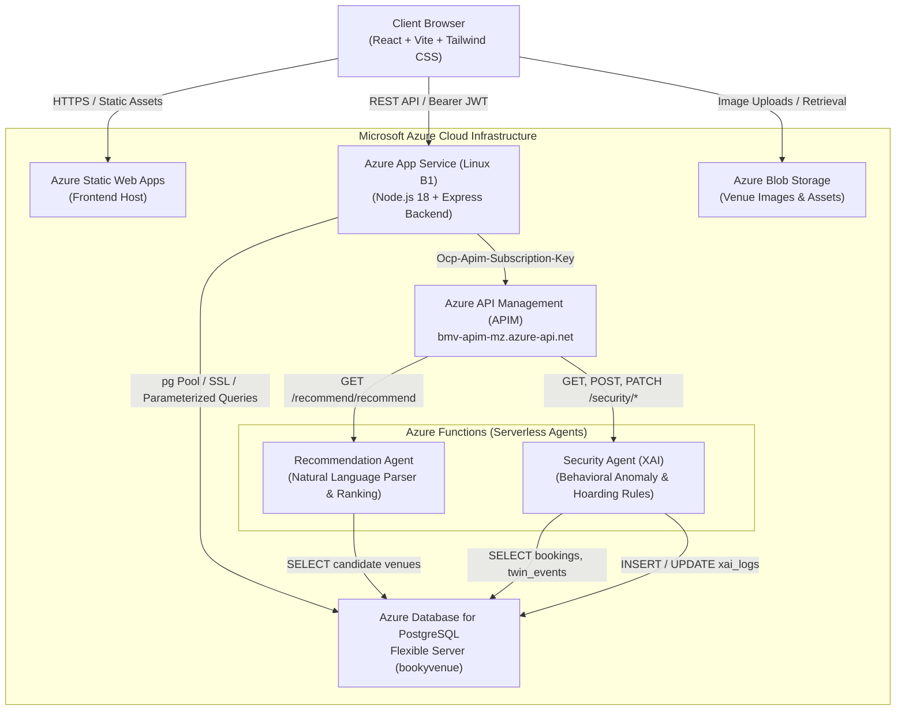
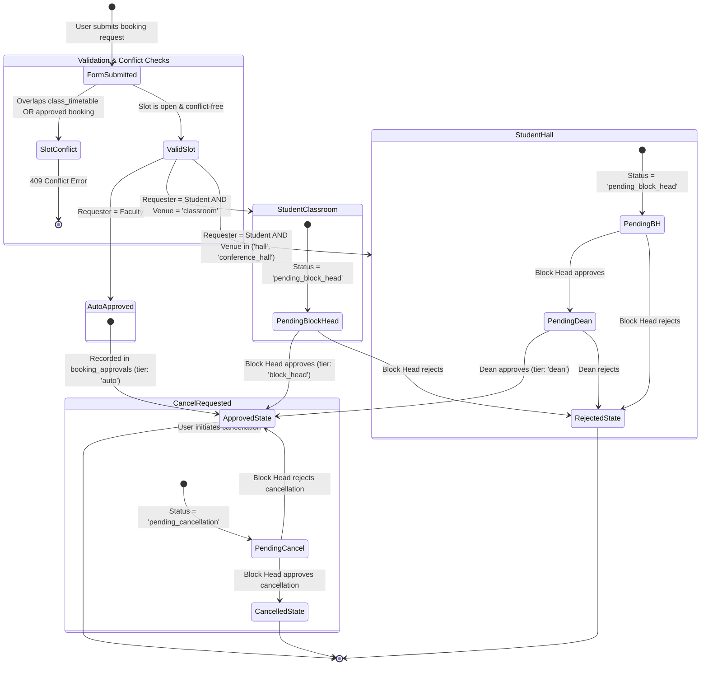
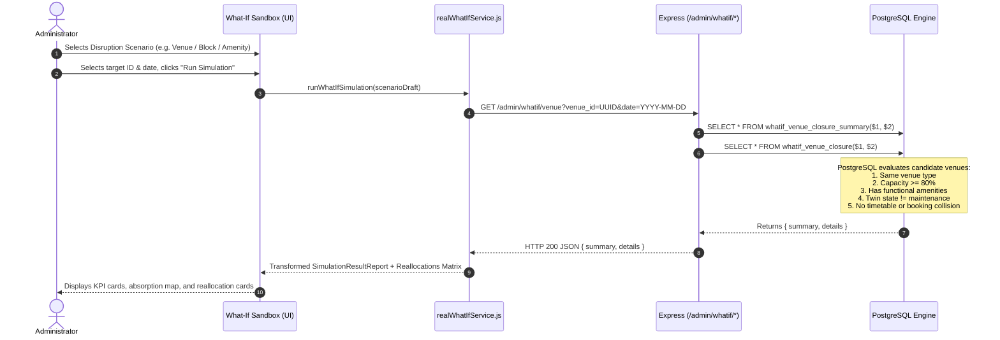

# BookMyVenue — System Architecture & Workflow Specifications

This document outlines the cloud infrastructure, tiered approval state machine, database-level conflict avoidance, Digital Twin synchronization, What-If simulation engine, and AI agent integration for the BookMyVenue campus platform.

---

## 1. Cloud & System Architecture

### Component Roles & Communication Paths
1. **Frontend (Azure Static Web Apps)**: Single Page Application built on React, Vite, and Tailwind CSS. Connects to backend with Bearer JWT tokens via `frontend/src/api.js`.
2. **Backend API (Azure App Service)**: Node.js Express server running on port 5000. Handles authentication, permissions, booking validation, and timetable exclusion checks.
3. **Azure Database for PostgreSQL (Flexible Server)**: Central data store (`bookyvenue`) utilizing the `btree_gist` extension for exclusion constraints, transactional triggers, and stored procedures.
4. **Azure API Management (APIM)**: Centralized API gateway exposing AI agent endpoints with subscription key authentication (`Ocp-Apim-Subscription-Key`).
5. **Azure Functions (Serverless AI Layer)**:
   - **Recommendation Agent**: Parses unstructured campus queries into structured constraints and computes compatibility scores.
   - **Security Agent (XAI)**: Periodically scans for anomalous reservation volume, rapid book-cancellations, and slot hoarding.

---

## 2. Tiered Booking Approval State Machine

BookMyVenue enforces institutional hierarchy rules based on requester role and venue classification:

### Approval Rules Summary Table

| Requester Role | Venue Type | Approval Tier Required | Final Database Status | Audit Log Tier |
|---|---|---|---|---|
| **Faculty** | Classroom, Hall, Conf Hall | Immediate Auto-Approval | `approved` | `tier: 'auto'` |
| **Student** | Classroom | Block Head only | `pending_block_head` → `approved` | `tier: 'block_head'` |
| **Student** | Hall, Conference Hall | Block Head → Dean/Admin | `pending_block_head` → `pending_dean` → `approved` | `tier: 'block_head'`, then `tier: 'dean'` |
| **Any** (Cancel) | Any approved booking | Block Head | `pending_cancellation` → `cancelled` | `tier: 'requester'`, then `tier: 'block_head'` |

---

## 3. Relational Audit Trail (`booking_approvals`)

Every state transition writes an immutable audit record to `booking_approvals`:
- `booking_id`: Foreign key referencing the target booking.
- `approver_id`: User ID of the decider (null for system auto-approvals).
- `tier`: One of `'auto'`, `'block_head'`, `'dean'`, `'requester'`.
- `decision`: One of `'approved'`, `'rejected'`, `'cancel_requested'`.
- `comment`: Free-text justification provided by the approver.
- `created_at`: Timestamp of decision.

---

## 4. Digital Twin & What-If Simulation Engine

### Digital Twin Synchronization Flow
1. **Trigger Hooks**: Database triggers on `bookings`, `booking_approvals`, and `venue_issue_reports` invoke `twin_refresh_venue(venue_id)` and write state changes into `twin_events`.
2. **Live View**: The view `v_campus_twin` denormalizes live availability, operational health, active issue count, and upcoming bookings count per venue.
3. **Frontend Polling**: [`DigitalTwinContext`](file:///c:/Users/zahwa/Downloads/BookMyVenue/frontend/src/context/DigitalTwinContext.jsx) polls `GET /admin/twin` every 30 seconds, maintaining a live synchronized campus graph.

---

## 5. Architectural Novelty vs. Base Literature

Compared to standard commercial booking systems (e.g., Airbnb, peer-to-peer venue rental scripts) and baseline university booking papers, BookMyVenue introduces:

1. **Non-Repudiable Relational Audit Machine**: Complete decoupling of booking requests from multi-tier approval logs (`booking_approvals`), maintaining full institutional accountability for accreditation compliance.
2. **Hard Database-Level Concurrency Control**: Zero race conditions via PostgreSQL exclusion constraints (`btree_gist` with `TSRANGE` and `&&` overlaps) enforced at the database kernel rather than vulnerable application code.
3. **Software Digital Twin with Health Scoring**: Continuous operational modeling reflecting equipment failures, active issue tickets, and scheduled maintenance.
4. **What-If Constraint Solver**: Deterministic simulation of campus disruptions (outages, equipment defects) that identifies impacted reservations and automatically computes compatible, conflict-free alternative venues.
5. **Dual Autonomous AI Agents**:
   - **Recommendation Agent**: Converts ambiguous natural language requests into structured constraints.
   - **Security Agent (XAI)**: Explainable rule-based anomaly detection protecting against rapid reservation-cancellation churn, high volume surges, and slot hoarding.

## Email OTP Signup

New accounts are created in two steps so that every account owns a working email address.

1. `POST /auth/signup/request` validates the form (name, email, password of at least 8 characters, role, and the admin registration code for admins) and rejects duplicate emails. The password is hashed with bcrypt, and a 6-digit one-time code is generated with `crypto.randomInt`. The code is emailed to the user and is never returned by the API.
2. `POST /auth/signup/verify` checks the code and, if it is correct, creates the user and returns the same `{ token, user }` response as login.
3. `POST /auth/signup/resend` issues a fresh code for the same pending signup.

Pending signups are held in server memory, not in the database, so the schema is unchanged:

| Rule | Value |
|---|---|
| Code lifetime | 5 minutes |
| Resend cooldown | 30 seconds |
| Wrong attempts allowed | 5, then the signup must be restarted |
| Code storage | SHA-256 hash only, compared with `timingSafeEqual` |

Limitations: pending codes are lost if the backend restarts, and they are not shared between multiple server instances. Both are acceptable for a single-instance deployment.

If `SMTP_HOST` is not set, the code is printed to the server console in development, and signup returns "Email service is not configured" in production.