# BookMyVenue — Entity-Relationship (ER) Diagram

This document models the relational schema of the BookMyVenue campus database (`bookyvenue` on Azure PostgreSQL Flexible Server). It includes the core campus hierarchy, tiered approval engine, timetable conflict layer, digital twin tracking, and explainable AI (XAI) security logs.

```mermaid
erDiagram
    BLOCKS ||--o{ FLOORS : contains
    BLOCKS ||--o{ USERS : "supervised by block head"
    FLOORS ||--o{ VENUES : contains
    VENUES ||--o{ VENUE_AMENITIES : provides
    AMENITIES ||--o{ VENUE_AMENITIES : classified_in
    
    USERS ||--o{ BOOKINGS : requests
    VENUES ||--o{ BOOKINGS : hosts
    BOOKINGS ||--o{ BOOKING_APPROVALS : audits
    USERS ||--o{ BOOKING_APPROVALS : decides
    
    VENUES ||--o{ CLASS_TIMETABLE : schedules
    USERS ||--o{ CLASS_TIMETABLE : "created by"
    
    VENUES ||--o{ VENUE_ISSUE_REPORTS : affects
    AMENITIES ||--o{ VENUE_ISSUE_REPORTS : "involves amenity"
    USERS ||--o{ VENUE_ISSUE_REPORTS : "reported by"
    USERS ||--o{ VENUE_ISSUE_REPORTS : "resolved by"

    VENUES ||--|| VENUE_TWIN_STATE : tracks
    VENUES ||--o{ AMENITY_TWIN_STATE : monitors
    AMENITIES ||--o{ AMENITY_TWIN_STATE : status
    VENUES ||--o{ TWIN_EVENTS : logs
    
    USERS ||--o{ XAI_LOGS : flags
    USERS ||--o{ XAI_LOGS : "reviewed by"
    
    SIMULATION_SCENARIOS ||--|| SIMULATION_RESULTS : generates
    BLOCKS ||--o{ SIMULATION_SCENARIOS : targets
    VENUES ||--o{ SIMULATION_SCENARIOS : targets
    AMENITIES ||--o{ SIMULATION_SCENARIOS : targets

    BLOCKS {
        UUID id PK
        VARCHAR name UK "Unique block name, e.g. Block A"
    }

    FLOORS {
        UUID id PK
        UUID block_id FK
        INT floor_number "1-indexed floor"
    }

    VENUES {
        UUID id PK
        UUID floor_id FK
        VARCHAR name "Unique room code / name"
        VARCHAR type "classroom | hall | conference_hall"
        INT capacity "Max seats"
        TEXT image_url
        BOOLEAN requires_dean_approval "GENERATED ALWAYS AS (type IN ('hall', 'conference_hall'))"
    }

    AMENITIES {
        UUID id PK
        VARCHAR name UK "e.g. Projector, Audio System, AC"
    }

    VENUE_AMENITIES {
        UUID venue_id PK,FK
        UUID amenity_id PK,FK
    }

    USERS {
        UUID id PK
        VARCHAR name
        VARCHAR email UK
        VARCHAR password_hash
        VARCHAR role "student | faculty | admin"
        BOOLEAN is_block_head "Block supervisor"
        UUID block_id FK "Supervised block"
        TIMESTAMPTZ created_at
    }

    BOOKINGS {
        UUID id PK
        UUID venue_id FK
        UUID user_id FK
        TSRANGE booking_range "Discrete naive campus timestamp range"
        VARCHAR status "pending_block_head | pending_dean | approved | rejected | pending_cancellation | cancelled"
        TEXT purpose
        TIMESTAMPTZ created_at
    }

    BOOKING_APPROVALS {
        UUID id PK
        UUID booking_id FK
        UUID approver_id FK "Nullable for auto-approval"
        VARCHAR tier "auto | block_head | dean | requester"
        VARCHAR decision "approved | rejected | cancel_requested"
        TEXT comment
        TIMESTAMPTZ created_at
    }

    CLASS_TIMETABLE {
        UUID id PK
        UUID venue_id FK
        SMALLINT day_of_week "0 = Sun, 1 = Mon ... 6 = Sat"
        TIME start_time
        TIME end_time
        TEXT label "Course code or lecture name"
        UUID created_by FK
        TIMESTAMPTZ created_at
    }

    VENUE_ISSUE_REPORTS {
        UUID id PK
        UUID venue_id FK
        UUID amenity_id FK "Nullable if entire room issue"
        UUID reported_by FK
        TEXT description
        VARCHAR status "open | resolved"
        UUID resolved_by FK
        TIMESTAMPTZ resolved_at
        TIMESTAMPTZ created_at
    }

    VENUE_TWIN_STATE {
        UUID venue_id PK,FK
        VARCHAR availability_state "available | booked | occupied | maintenance | partially_unavailable"
        INT occupancy_count
        VARCHAR operational_state "good | needs_attention | unavailable"
        VARCHAR maintenance_state "none | scheduled | in_progress"
        TIMESTAMPTZ last_updated
    }

    AMENITY_TWIN_STATE {
        UUID venue_id PK,FK
        UUID amenity_id PK,FK
        VARCHAR status "working | faulty | under_maintenance"
        VARCHAR issue_state "none | open"
        TIMESTAMPTZ last_updated
    }

    TWIN_EVENTS {
        UUID id PK
        UUID venue_id FK
        UUID amenity_id FK
        VARCHAR event_type "booking_created | booking_status_changed | approval_decision | issue_reported | issue_resolved | state_refreshed"
        VARCHAR source_table
        UUID source_id
        UUID actor_id FK
        JSONB old_state
        JSONB new_state
        TIMESTAMPTZ created_at
    }

    SIMULATION_SCENARIOS {
        UUID id PK
        VARCHAR scenario_type "block_closure | venue_closure | amenity_failure | demand_increase"
        UUID target_block_id FK
        UUID target_venue_id FK
        UUID target_amenity_id FK
        DATE sim_date
        JSONB parameters
        UUID created_by FK
        TIMESTAMPTZ created_at
    }

    SIMULATION_RESULTS {
        UUID id PK
        UUID scenario_id FK
        INT affected_bookings
        INT auto_reassignable
        INT needs_admin_action
        JSONB details "Alternative suggestions matrix"
        TIMESTAMPTZ created_at
    }

    XAI_LOGS {
        UUID id PK
        VARCHAR rule_code "RAPID_BOOK_CANCEL | HIGH_BOOKING_VOLUME | SLOT_HOARDING"
        VARCHAR severity "low | medium | high"
        UUID user_id FK
        TEXT explanation "Plain English reasoning"
        JSONB evidence
        JSONB twin_context
        TEXT dedup_key UK "rule_user_date unique key"
        VARCHAR status "open | reviewed | dismissed"
        UUID reviewed_by FK
        TIMESTAMPTZ reviewed_at
        TIMESTAMPTZ created_at
    }
```



## Key Database Constraints & Integrity Guarantees

1. **Exclusion Constraint on Double Bookings (`btree_gist`)**:
   ```sql
   EXCLUDE USING GIST (venue_id WITH =, booking_range WITH &&)
   WHERE (status IN ('approved', 'pending_block_head', 'pending_dean', 'pending_cancellation'))
   ```
   Ensures that no two bookings can ever occupy the same venue during overlapping times unless rejected or cancelled.

2. **Single Calendar Day Enforcement**:
   ```sql
   CHECK (lower(booking_range)::date = upper(booking_range)::date)
   ```
   Prevents multi-day span errors; all bookings must start and end on the same calendar day.

3. **Dean Approval Virtual Column**:
   ```sql
   requires_dean_approval BOOLEAN GENERATED ALWAYS AS (type IN ('hall', 'conference_hall')) STORED
   ```
   Eliminates workflow sync bugs by making dean approval required strictly at the database schema level for halls and conference rooms.

4. **Class Timetable Conflict Checking**:
   Evaluated at reservation time by checking `day_of_week`, `start_time`, and `end_time` against `class_timetable`.

